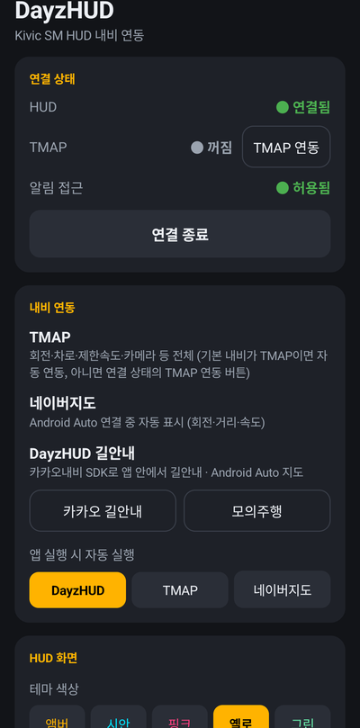
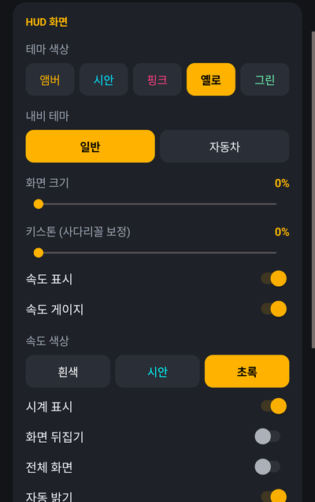
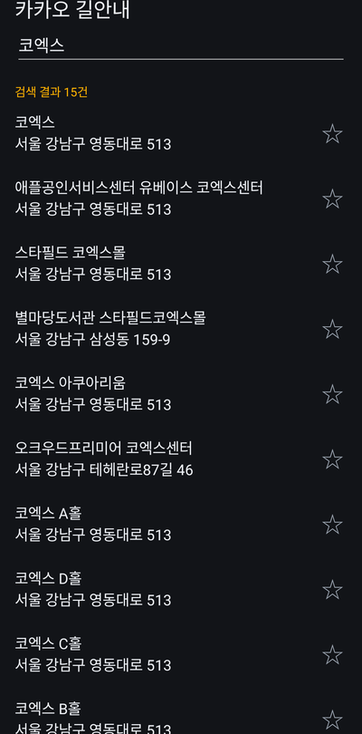

# DayzHUD

지원이 끝난 **Kivic SM HUD**(차량용 HUD)에 내비 길안내를 블루투스(BLE)로 다시 띄우는 안드로이드 앱입니다.
HUD가 화살표·숫자를 직접 그리므로, 앱은 회전 종류·거리·속도 같은 값만 보냅니다.

```
[TMAP 앱] ── EDC SDK ─────────────┐
[네이버지도] ── 알림 (Android Auto) ─┼─▶ [DayzHUD] ── BLE ──▶ [Kivic SM HUD]
[카카오내비 SDK] ── 앱 안 길안내 ────┘        └─▶ Android Auto 차량 화면 (카카오 지도)
```

| 메인 화면 | HUD 화면 설정 | 카카오 길안내 검색 |
|:---:|:---:|:---:|
|  |  |  |
| 연결 상태, 내비 연동, 자동 실행 | 테마·크기·키스톤·속도·밝기, 카톡·문자 알림 | 목적지 검색, ☆로 즐겨찾기 고정 |

## 기능

| 내비 | 방식 | HUD에 나오는 것 | 조건 |
|---|---|---|---|
| **TMAP** | TMAP 앱 안내를 EDC SDK로 받음 | 회전·거리·차로·제한속도·단속카메라 | TMAP 앱 설치 + **유료** TMAP API 키 |
| **네이버지도** | Android Auto 알림을 읽음 | 회전·거리·속도(폰 GPS) | Android Auto 연결 중일 때만, 알림 접근 허용 |
| **카카오내비 SDK** | 앱 안에서 직접 길안내 | 회전·거리·차로·남은 거리/시간·카메라 | 카카오 네이티브 앱 키 (개인 무료) |

- **Android Auto**: 차량 화면에서 DayzHUD를 열면 카카오 지도로 길안내합니다.
  - 목적지 검색과 즐겨찾기·최근 목적지를 쓸 수 있어요.
  - 지도 확대·축소, 현재 위치로 돌아가기, 지도 끌기, 재탐색, 안내 종료가 됩니다.
  - 지도 위에 속도·제한속도 정보판이 나옵니다.
- **즐겨찾기**: 폰의 카카오 길안내 검색 화면에서 ☆를 누르면 맨 위에 고정돼요. 차량 목록에도 ★로 나옵니다.
- **HUD 화면 설정**: 테마 색, 화면 크기, 키스톤, 밝기, 속도·시계 표시 등. 바꾸면 바로 HUD에 보내요.
- **카톡·문자 알림**: 카톡은 "보낸 사람 : 내용", 문자는 보낸 사람과 내용을 HUD에 10초 띄워요. 아이콘은 HUD가 그립니다.
  - 알림 접근 허용이 필요하고, **HUD 화면**에서 각각 끌 수 있어요.
  - 카톡 알림 미리보기를 꺼 두면 내용 대신 "새 메시지"만 나옵니다.
- 카카오내비 앱 자체의 안내는 읽을 수 없습니다. 알림에 회전 정보가 없어서예요. 카카오는 앱 안 길안내(SDK)를 씁니다.

## 필요한 것

- Android 10 이상 폰
- Kivic SM HUD
  - 원본 Kivic 앱이 HUD에 먼저 붙어 있으면 연결이 안 됩니다. 원본 앱을 지우거나 블루투스 연결을 끊어 주세요.
- (선택) Android Auto 차량. 차량 화면은 **Play 스토어에서 설치한 앱**에만 나와요 (Play Console 내부 테스트).
  - Android Auto 17.7부터는 APK로 직접 설치한 지도 앱을 '알 수 없는 출처'를 켜도 차량 앱 목록에서 숨깁니다. HUD 표시는 APK로도 됩니다.
  - PC의 DHU(Desktop Head Unit)는 이 검사를 건너뛰어서 APK로도 보여요.

## 빌드·설치

```bash
cd android
./gradlew assembleDebug        # JDK 17
adb install -r app/build/outputs/apk/debug/app-debug.apk
```

API 키는 둘 중 한 가지로 넣습니다. 둘 다 있으면 앱에서 입력한 값을 씁니다.
1. **앱에서 입력**: 메인 화면 **API 키** → 키 입력 → 저장
2. **빌드할 때 넣기**: `android/secrets.properties.example`을 `android/secrets.properties`로 복사해서 값을 채움 (git에 안 올라감)

## 사용법

1. HUD를 켜고 앱에서 **HUD 연결**을 누릅니다. 처음에는 블루투스·위치·알림 권한을 허용해 주세요.
   - 연결은 백그라운드 서비스로 유지되고, 끊기면 자동으로 다시 붙어요.
2. 쓰는 내비에 맞게:
   - **TMAP**: **TMAP 연동**을 누른 뒤 TMAP 앱에서 안내를 시작합니다.
   - **네이버지도**: 알림 접근을 허용하고, Android Auto에 연결해 네이버지도로 안내합니다.
   - **카카오**: **카카오 길안내**를 눌러 목적지를 검색합니다. 차에서는 Android Auto의 DayzHUD에서 목적지를 고릅니다.
3. **앱 실행 시 자동 실행**에서 평소 쓰는 내비를 고릅니다.
   - **DayzHUD**(기본값)는 다른 앱을 띄우지 않고 DayzHUD 안의 카카오 SDK 길안내를 써요.
   - **TMAP**·**네이버지도**를 고르면 앱을 열 때 HUD 연결과 함께 그 앱이 실행돼요.
4. 앱 안 **도움말**에도 같은 내용과 내비별 설정·키 발급 방법이 있어요.

## 내비별 설정 (API 키 발급)

### TMAP API 키 (EDC)

> 무료 요금제는 **하루 1건**이라 실제로는 쓸 수 없습니다. **Premium 요금제**에 가입해야 해요 (1건당 110원, 2026-11 기준).

1. [SK open API](https://openapi.sk.com)에 회원 가입하고 로그인합니다.
2. **앱 사용하기**: 앱을 만들고 **앱키(appKey)**를 발급받습니다.
3. **상품 사용하기**: TMAP API 상품을 구매하고 **Premium** 요금제를 고릅니다.
4. 앱의 **API 키** → TMAP 칸에 앱키 입력 → 저장 → **TMAP 연동**

- 요금: <https://openapi.sk.com/products/calc?svcSeq=4&menuSeq=5>
- 상품 구매·이용 가이드: <https://openapi.sk.com/products/detail?svcSeq=60&menuSeq=126>
- 인증 실패(`INVALID_API_KEY`)가 나오면 상품 구매와 요금제 상태를 확인하세요.

### 네이버지도 (API 키 필요 없음)

네이버지도는 공개된 길안내 연동이 없어서, Android Auto용 안내 알림을 읽습니다. 그래서 **Android Auto에 연결해 네이버지도로 안내할 때만** 됩니다. 폰만으로 안내하면 알림에 회전 정보가 없어요.

1. 앱의 **알림 접근 설정 열기** → DayzHUD 허용
   - 회색으로 막혀 있으면: 설정 > 앱 > DayzHUD > ⋮ > **제한된 설정 허용** 후 다시 허용
2. **HUD 연결** 후 차(Android Auto)에서 네이버지도로 안내를 시작합니다.
   - HUD에는 회전·거리가 나오고, 속도는 폰 GPS로 채워요.

- 남은 거리·도착 시각·제한속도는 차량 화면에만 있어서 가져올 수 없습니다.
- 회전 방향은 알림 아이콘 그림으로만 와서, 수집한 아이콘 7종(좌·우회전, 직진, 유턴, 2시 방향, 왼쪽 도로, 도착)만 화살표로 바꿔요.
  - 처음 보는 아이콘은 화살표 없이 거리만 나오고, 로그에 `네이버 새 회전 아이콘 <해시>`로 남습니다.
  - 그 해시를 `NaverMapping.TURN`에 추가하면 돼요.

### 카카오 네이티브 앱 키 (카카오내비 SDK)

개인·비상업 용도는 무료이고 별도 신청이 없습니다 (실시간 길안내 하루 100,000건).

1. [카카오 디벨로퍼스](https://developers.kakao.com/console/app)에 로그인 → **내 애플리케이션** → **애플리케이션 추가**
2. **플랫폼 > Android** 등록
   - 패키지명: `com.dayz.hud`
   - 키 해시: 앱 **도움말**에 나오는 값을 누르면 복사돼요. 서명 키마다 다르니 직접 빌드했다면 꼭 자기 값을 넣으세요.
     PC에서 구하려면:
     ```bash
     keytool -exportcert -alias androiddebugkey -keystore ~/.android/debug.keystore -storepass android | openssl sha1 -binary | openssl base64
     ```
3. **앱 키 > 네이티브 앱 키**를 앱의 **API 키** → 카카오 칸에 입력 → 저장 → 앱을 완전히 닫고 다시 열기
   - 카카오 SDK는 한 번 초기화되면 키를 바꿀 수 없어서 다시 열어야 합니다.

- `C103` 오류가 나오면 패키지명·키 해시 등록을 확인하세요.

## 저장소 구성

```
DayzHUD/
├─ PLAN.md                 # 개발 계획·진행 상황·실측 기록
├─ docs/kivic-protocol.md  # Kivic HUD BLE 프로토콜 정리
├─ android/                # 앱 (Kotlin, minSdk 29)
└─ tools/                  # PC 시험 도구 (Android Auto DHU 실행·캡처·클릭, HUD 덤프)
```

- 단위 테스트: `cd android && ./gradlew testDebugUnitTest` (HUD 패킷 인코딩, 내비별 회전 코드 변환 등)
- Android Auto 시험: PC의 DHU(Desktop Head Unit)와 USB로 연결한 폰으로 `bash tools/aa_test.sh`

## 주의

- 개인 사용 목적입니다. HUD 프로토콜은 갖고 있는 기기와 함께 쓰기 위해 분석했으며, 디컴파일한 코드는 이 저장소에 넣지 않았습니다.
- 운전 중에는 화면 조작을 하지 마세요. 표시 정보는 회전·거리 중심으로 줄였습니다.
